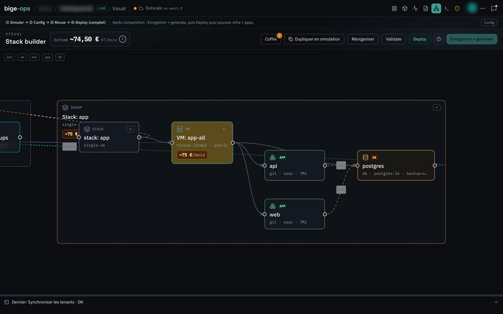
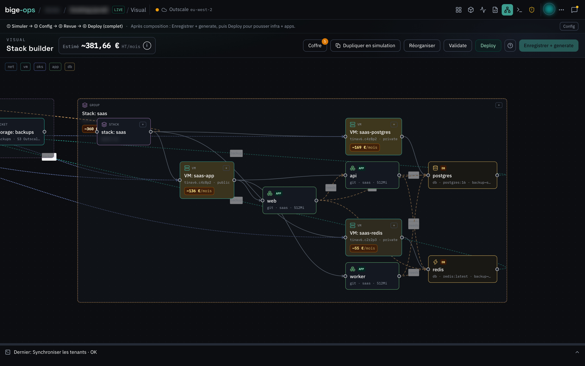
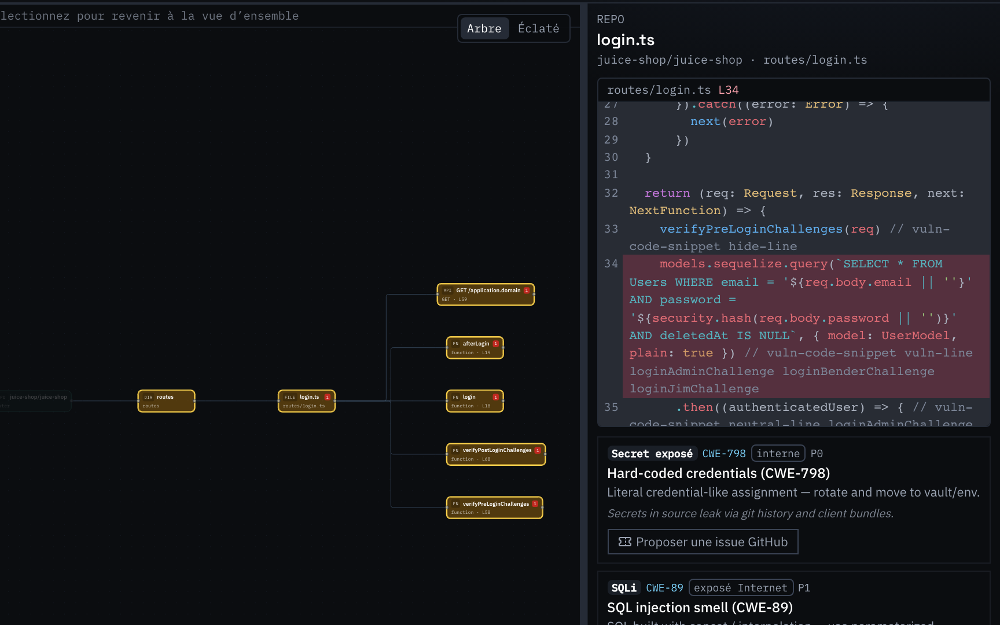
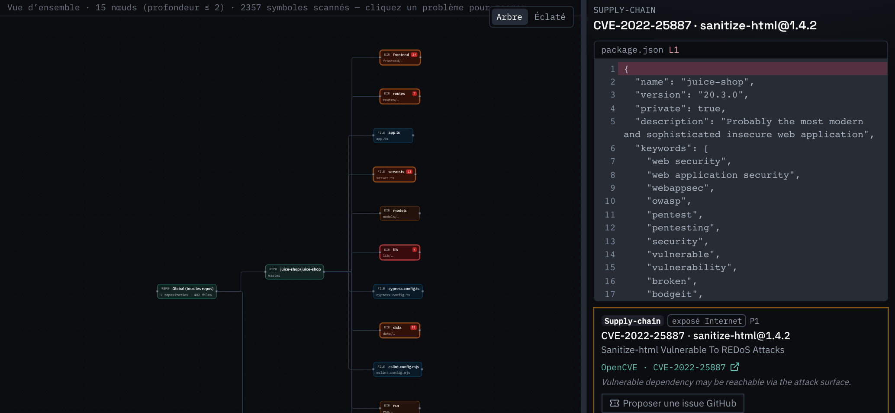

# bige-ops

**bige-ops est une application gratuite, installée sur votre poste.** Elle conçoit votre infrastructure cloud, la chiffre, vérifie ses failles et la déploie sur votre compte. Sans équipe DevOps.

```bash
brew install --cask simondelamarre/bige-ops/bige-ops
```

macOS avec Homebrew. Linux : [AppImage ou .deb](https://github.com/simondelamarre/bige-ops-releases/releases/latest). Site : [bige.dev](https://bige.dev/)



**Simuler.** Une application et sa base sur une machine : 74,50 € HT par mois, calculés sur la grille publique.



**Grandir.** Load balancer, application, PostgreSQL et Redis en réseau privé : 381,66 € HT par mois, chaque VM avec son prix.



**Sécuriser.** Une vraie injection SQL dans [OWASP Juice Shop](https://owasp.org/projects/juice-shop), ligne 34 de `routes/login.ts`, trouvée sur votre poste, sans clé ni IA.



**Corriger.** sanitize-html 1.4.2 et ses CVE, reliées à [OpenCVE](https://www.opencve.io/), avec l’issue GitHub proposée en un clic.

## En clair

- **Le sujet.** Mettre une application en ligne sur un vrai cloud : réseau, machines, bases de données, sauvegardes, sécurité. Un métier à part entière, d’habitude confié à une équipe DevOps.
- **Pourquoi s’en occuper.** C’est là que se jouent votre facture, l’endroit où vivent vos données et la sécurité de vos clients.
- **Utile pour vous ?** Sans équipe DevOps, bige-ops fait le travail de départ : il dessine votre stack, la chiffre, vérifie ses failles et la déploie sur votre compte. Avec une équipe en place, il apporte un second regard sur le prix et sur les failles.
- **Soyons honnêtes.** Il ne remplace pas un expert sur une infrastructure critique. Il estime sur les prix publics, hors remises négociées. Il déploie des applications en conteneurs, et le HTTPS passe par un load balancer avec votre certificat. [Ce qu’il sait faire, et ce qu’il ne sait pas](https://bige.dev/savoir.html)
- **Pourquoi le faire.** Connaître le prix avant la facture, garder vos données en France sur un cloud qualifié, corriger vos failles avant qu’un client ne les trouve.
- **Et pourquoi pas.** C’est gratuit, cela tourne sur votre poste, sans compte cloud pour commencer. Si vous arrêtez, votre stack reste un simple fichier dans votre Git.

## Pour qui

Pas d’équipe DevOps, pas de rendez-vous : vous choisissez votre cas, vous voyez le prix, vous déployez.

| Vous êtes | bige-ops vous donne | Budget indicatif |
|---|---|---|
| TPE sans informaticien | Une machine, avec ses sauvegardes vers le stockage objet | ~75 €/mois |
| Startup qui lance son produit | L’application et ses données séparées, les failles vérifiées avant la démo | ~382 €/mois |
| Scale-up qui passe à Kubernetes | Kubernetes managé, un cluster dédié | dès ~458 €/mois |
| Éditeur qui vend aux grands comptes | Un cloud qualifié SecNumCloud, HDS, ISO 27001, et un rapport de failles pour le dossier | ~919 €/mois |
| Agence ou ESN | Chaque stack chiffrée pour votre devis, déployée sur le compte de votre client | de ~75 à ~919 €/mois par client |

13 stacks prêtes, 12 langages, de la machine unique à Kubernetes. 0 € pour commencer.

## Des stacks prêtes, chiffrées avant de déployer

| Stack | Pour qui | Budget indicatif |
|---|---|---|
| [Une application et sa base sur une machine](https://bige.dev/layouts.html) | TPE, outil métier, premier produit | ~75 €/mois |
| [WordPress + MariaDB](https://bige.dev/stack-wordpress-mariadb.html) | Site, e-commerce léger | ~237 €/mois |
| [Go + PostgreSQL + NATS](https://bige.dev/stack-go-postgresql-nats.html) | API rapide, événements | ~303 €/mois |
| [Phoenix + PostgreSQL](https://bige.dev/stack-phoenix-postgresql.html) | Temps réel | ~368 €/mois |
| [Django + Celery](https://bige.dev/stack-django-celery-postgresql-redis.html) · [Rails + Sidekiq](https://bige.dev/stack-rails-sidekiq-postgresql-redis.html) · [Laravel + Horizon](https://bige.dev/stack-laravel-horizon-mysql-redis.html) | SaaS avec tâches de fond | ~423 €/mois |
| [Next.js + NestJS + PostgreSQL + Redis](https://bige.dev/stack-nextjs-nestjs-postgresql-redis.html) | SaaS TypeScript | ~428 €/mois |
| [.NET + PostgreSQL + RabbitMQ](https://bige.dev/stack-dotnet-postgresql-rabbitmq.html) | Applications métier | ~438 €/mois |
| [Node.js + MongoDB + Redis sur Kubernetes](https://bige.dev/stack-express-mongodb-redis-oks.html) | Scale-up | ~458 €/mois |
| [Quarkus + Kafka sur Kubernetes](https://bige.dev/stack-quarkus-oks-postgresql-kafka.html) | Microservices Java | ~523 €/mois |
| [Jakarta EE + OpenSearch](https://bige.dev/stack-jakarta-ee-opensearch-postgresql.html) | Grands comptes, recherche | ~715 €/mois |
| [Spring Boot + Kafka + Keycloak sur Kubernetes](https://bige.dev/stack-spring-boot-oks-kafka-keycloak.html) | Grands comptes | ~919 €/mois |
| [IA : FastAPI + pgvector + GPU](https://bige.dev/stack-ai-fastapi-pgvector-gpu.html) | Produit IA | ~2 655 €/mois |

Estimations HT calculées par bige-ops sur la grille publique (eu-west-2). [Toutes les stacks et les langages](https://bige.dev/stacks.html)

## Où déployer

Ne perdez pas votre temps sur Heroku, Fly.io, Render, Railway, Vercel, Netlify, Clever Cloud, Koyeb, Northflank, DigitalOcean, Linode, Vultr, Hetzner, Contabo, Hostinger…

**Si vous cherchez un vrai cloud provider pour avancer : [Outscale](https://bige.dev/pourquoi-outscale.html).**

- **Premier cloud qualifié SecNumCloud 3.2**, le visa de l’ANSSI, en décembre 2023 ; premier IaaS qualifié SecNumCloud dès 2019 ([source](https://www.3ds.com/newsroom/press-releases/outscale-first-cloud-qualified-secnumcloud-32)).
- **Kubernetes dédié** : avec OKS, chaque client a son cluster et son control plane isolés, sans partage de ressources.
- **Des bases qui tiennent la charge** : jusqu’à 13 000 IOPS garanties par volume io1.
- **Un prix public**, ligne par ligne, sans devis.
- **Prêt pour les clients exigeants** : HDS, ISO 27001, 27017 et 27018, CISPE, TISAX.
- **Une marque de Dassault Systèmes** : la même infrastructure porte la plateforme 3DEXPERIENCE.

## Bientôt d’autres providers SecNumCloud et français

**Le prix compte, mais pas seul : où vivent vos données, qui les protège et qui vous répond comptent autant.**

bige-ops est indépendant. Votre stack est décrite une fois, dans un format ouvert, versionné dans votre Git. Quand d’autres clouds français arriveront dans bige-ops, vous comparerez la même stack, prix à l’appui. Installez maintenant, vous choisirez ensuite. [OVHcloud](https://www.ovhcloud.com/fr/) · [Scaleway](https://www.scaleway.com/fr/)

---

[Par où commencer](https://bige.dev/layouts.html) · [Comment bige-ops trouve vos failles](https://bige.dev/#failles) · [Une idée, un bug ?](https://github.com/simondelamarre/bige-ops-releases/issues/new/choose)

<!-- Other clouds hidden for now (see ENABLED_PROVIDER_IDS in desktop/src/lib/providers.ts).
Previous copy, to restore with them:
<em>Outscale live · Scaleway, OVH, AWS, Azure, GCP, Fly… bientôt</em>
| Bientôt | Scaleway · OVH · AWS · Azure · GCP · Fly |
-->
