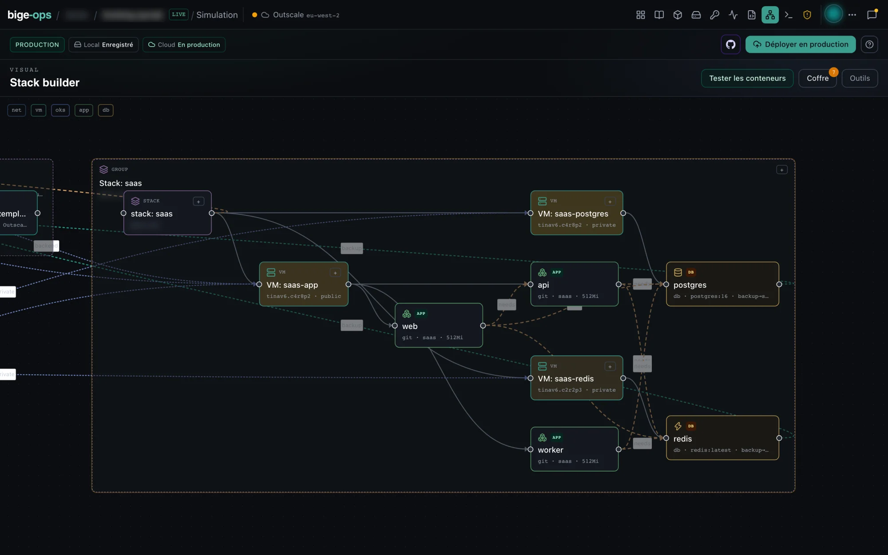
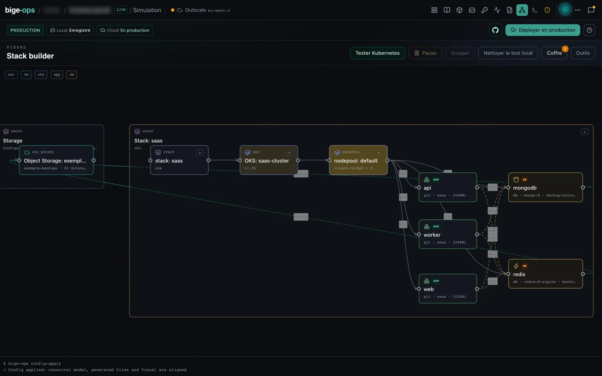
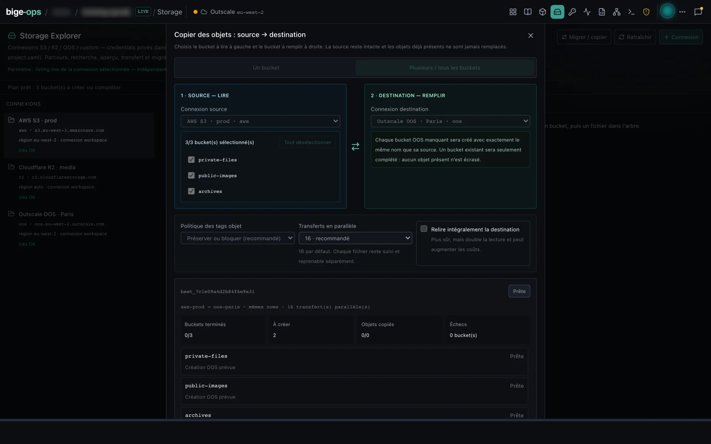
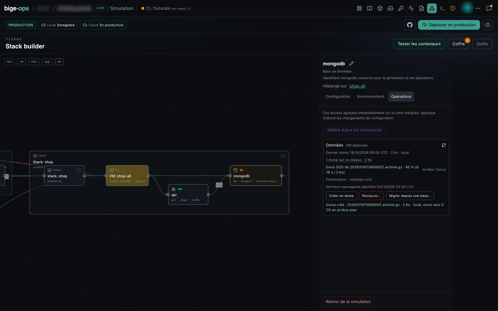
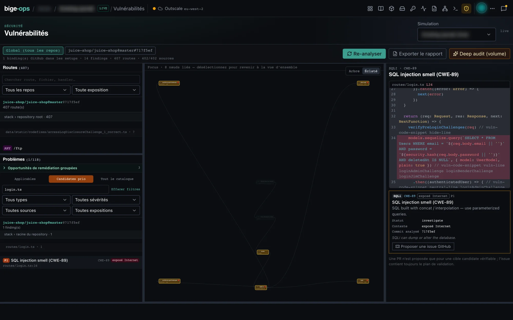

<p align="center">
  
</p>

<h1 align="center">Simple comme un PaaS.<br/>Flexible comme un IaaS.</h1>

<p align="center">
  <strong>bige-ops</strong> est une application gratuite, installée sur ton poste.<br/>
  Tu relies ton dépôt, tu simules ta stack, tu la testes en local et tu la déploies sur ton propre compte cloud.<br/>
  <strong>Sans DevOps.</strong>
</p>

<p align="center">
  <a href="https://bige.dev/install.html#macos"></a>
  &nbsp;
  <a href="https://github.com/simondelamarre/bige-ops-releases/releases/latest"></a>
</p>

```bash
brew install --cask simondelamarre/bige-ops/bige-ops
```

<p align="center"><strong>Gratuit · sans carte bancaire · sans compte cloud pour commencer</strong> · <a href="https://bige.dev/">bige.dev</a></p>

---

## Simple comme un PaaS

Tu veux mettre ton produit en ligne, pas devenir DevOps. bige-ops fait le travail d’une plateforme managée, sur ton poste.

- **Simule.** Pars d’une stack prête ou dessine la tienne. Le Visual et la configuration restent la même chose : un seul Appliquer, local et vérifié. [Par où commencer](https://bige.dev/layouts.html)
- **Teste en local.** Tes conteneurs, ou ton Kubernetes en local, avant de toucher au cloud. Pas besoin de compte cloud pour ça.
- **Déploie.** Tu relies ton dépôt et tu cliques sur Déployer. bige-ops écrit le Terraform et les manifests, te montre le plan, puis déploie sur ton compte. [13 stacks prêtes](https://bige.dev/stacks.html)
- **Sécurise.** Tes failles, les plus exposées d’abord : la ligne de code, la version corrigée, l’issue GitHub en un clic.

<p align="center"></p>
<p align="center"><em>La même stack sur Kubernetes : ton cluster, ton node pool, tes pods. Testée en local avant le cloud.</em></p>

## Flexible comme un IaaS

Ce que tu gagnes à quitter un PaaS, sans perdre sa simplicité.

- **Ton compte, tes machines.** VMs, cluster Kubernetes dédié, réseau privé, load balancer : tout est créé sur ton compte, rien ne passe par nous.
- **Tes versions, tes licences.** PostgreSQL, MongoDB, Redis : tu choisis l’image et la version. Pas d’image revendue, pas de base captive.
- **Ton infra en clair.** Terraform et manifests générés, lisibles, versionnés dans ton Git : chaque simulation est une branche.
- **Une seule facture cloud.** Tes services et tes données rejoignent ton compte, au lieu d’un abonnement par PaaS, BaaS et SaaS.
- **Tu grandis sans tout réécrire.** Une machine, puis l’app et ses données séparées, puis Kubernetes : la même stack, décrite une fois.

Ne perds pas ton temps sur Heroku, Fly.io, Render, Railway, Vercel, Netlify, Clever Cloud, Koyeb, Northflank, DigitalOcean, Linode, Vultr, Hetzner, Contabo, Hostinger…

### Si tu cherches un vrai cloud provider pour avancer : [Outscale](https://bige.dev/pourquoi-outscale.html).

- **Premier cloud qualifié SecNumCloud 3.2.** Visa de l’ANSSI pour son cloud public, en décembre 2023. ([source](https://www.3ds.com/newsroom/press-releases/outscale-first-cloud-qualified-secnumcloud-32))
- **Kubernetes managé, rien qu’à toi.** Chaque client a son cluster dédié, son control plane isolé, sans partage de ressources.
- **Des bases qui tiennent la charge.** Jusqu’à 13 000 IOPS garanties par volume io1.
- **Prêt pour les clients exigeants.** HDS pour la santé, ISO 27001, 27017 et 27018, CISPE, TISAX.
- **Une marque de Dassault Systèmes.** La même infrastructure porte la plateforme 3DEXPERIENCE.

## Migre sans peur

Quitter un PaaS, c’est d’abord déplacer des données. bige-ops le fait en copie contrôlée : la source n’est jamais supprimée, rien n’est écrasé.

- **Object Storage.** Connecte AWS S3, Cloudflare R2, OOS ou un endpoint compatible S3. Explore, prévisualise tes fichiers, puis reproduis un bucket ou tous sur OOS : mêmes noms, copie parallèle, reprise après une coupure. [Voir](https://bige.dev/oos.html)
- **Bases de données.** Chaque base a son panneau Données : dump, envoi vers l’Object Storage, restauration, migration depuis une autre base.

<p align="center"></p>
<p align="center"></p>

## Tes failles, les plus exposées d’abord

Sur ton poste, sans clé ni IA :

- le scan suit la **branche active** de chaque dépôt, et oublie les résultats d’une branche que tu quittes ;
- les routes sont regroupées par **dépôt, stack et service**, avec leur exposition : publique, interne ou source uniquement ;
- injections, mots de passe en clair, API ouvertes, et les **CVE de tes bibliothèques** avec la version corrigée ([OSV](https://osv.dev/), [OpenCVE](https://www.opencve.io/) avec ta clé) ;
- un clic propose l’**issue GitHub** à ton équipe ; le rapport s’exporte en Markdown ou PDF.

<p align="center"></p>
<p align="center"><em>Une injection SQL réelle dans <a href="https://owasp.org/projects/juice-shop">OWASP Juice Shop</a> : la ligne, l’exposition, l’issue en un clic.</em></p>

[Comment bige-ops trouve tes failles →](https://bige.dev/#failles)

## Gratuit, sans intermédiaire

**bige-ops est gratuit.** Ton cloud, tu le paies à ton fournisseur, sur ton compte. Personne ne se place entre les deux.

Avant de déployer, la simulation t’en donne une estimation dans l’app, sur les tarifs publics du fournisseur : le catalogue se synchronise par la CLI, et la remise que tu négocies vient en plus.

## Démarrer en trois étapes

1. **Installe** : la commande ci-dessus sur macOS, l’AppImage ou le .deb sur Linux.
2. **Simule et teste** : connecte-toi avec GitHub, choisis un dossier, pars d’une stack prête et lance-la en local.
3. **Déploie** : tu connectes ton compte cloud quand tu es prêt, tu relis le plan, tu déploies.

## Nouveautés 0.9 et 0.10

- **Un panneau Données par base.** Dump, restauration et migration ; les dumps locaux sont listés, pesés et supprimables ; l’envoi vers l’Object Storage tourne en arrière-plan et se reprend.
- **Kubernetes en local.** Teste une stack OKS sur ton poste, depuis un brouillon, avant le cloud.
- **Images et Dockerfiles guidés.** Registre GitHub (GHCR) proposé pour OKS, revue du Dockerfile avant le build, monorepos compris.
- **Dépôts de travail propres.** Les fichiers locaux, dumps et données de test ne partent jamais dans ton Git.

Les recettes sur de vrais comptes cloud restent séparées des tests automatisés : avant une infra critique, garde un expert dans la boucle.

## Questions franches

- **C’est prêt pour la prod ?** bige-ops est jeune (0.10) et avance vite. Avant chaque déploiement, tu relis le plan de ce qui va changer, et ta stack reste un fichier versionné dans ton Git.
- **Et le HTTPS ?** Il passe par le load balancer, avec ton certificat chargé dans le cloud : bige-ops le branche pour toi.
- **Où sont mes secrets ?** Sur ton poste, dans un coffre local, jamais dans tes fichiers.
- **Pourquoi brew sur macOS ?** Une commande installe l’app et la prépare pour macOS. Sur Linux : AppImage ou .deb.

---

<h3 align="center">Bientôt d’autres providers SecNumCloud et français</h3>

<p align="center">
  <strong>bige-ops est indépendant.</strong> Ta stack est décrite une fois. Quand d’autres clouds français arriveront dans bige-ops,<br/>
  tu déploieras la même stack chez eux. <strong>Installe maintenant, tu choisiras ensuite.</strong><br/>
  <a href="https://www.ovhcloud.com/fr/">OVHcloud</a> · <a href="https://www.scaleway.com/fr/">Scaleway</a>
</p>

<p align="center">
  <a href="https://bige.dev/layouts.html">Par où commencer</a> ·
  <a href="https://bige.dev/stacks.html">Stacks et langages</a> ·
  <a href="https://github.com/simondelamarre/bige-ops-releases/issues/new/choose">Une idée, un bug ?</a>
</p>

<!-- Other clouds hidden for now (see ENABLED_PROVIDER_IDS in desktop/src/lib/providers.ts).
Previous copy, to restore with them:
<em>Outscale live · Scaleway, OVH, AWS, Azure, GCP, Fly… bientôt</em>
| Bientôt | Scaleway · OVH · AWS · Azure · GCP · Fly |
-->
