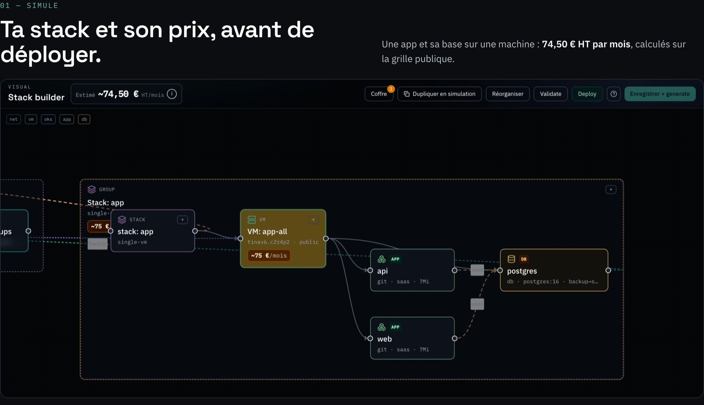
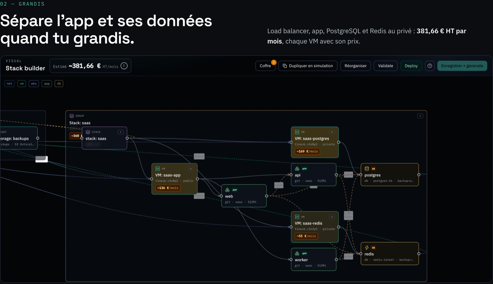
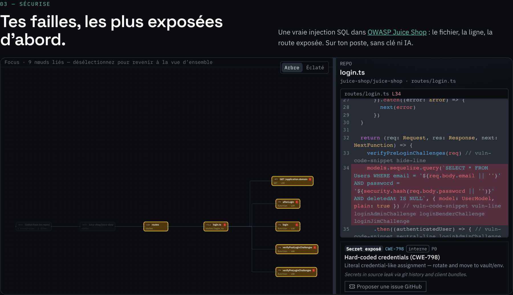
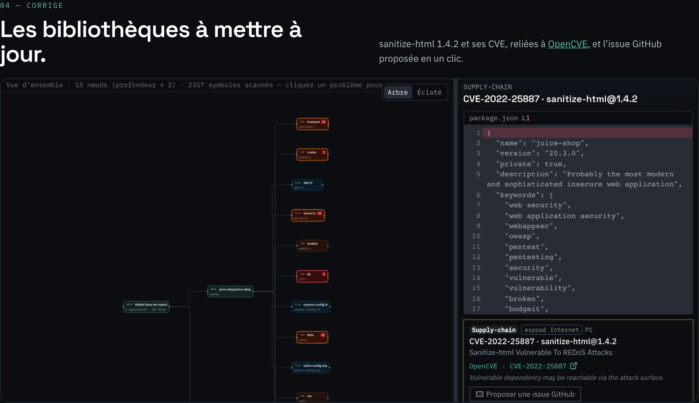

<p align="center">
  
</p>

<h3 align="center">La puissance d’un vrai cloud, la simplicité d’un PaaS.</h3>
<p align="center">bige-ops simule ton infra, te montre ce qu’elle coûte et la déploie sur ton compte. Pas besoin de DevOps.</p>

<p align="center">
  <a href="https://bige.dev/install.html#macos"></a>
  &nbsp;
  <a href="https://github.com/simondelamarre/bige-ops-releases/releases/latest"></a>
</p>

```bash
brew install --cask simondelamarre/bige-ops/bige-ops
```

<p align="center"><strong>Gratuit · local · sans compte cloud pour commencer</strong> · <a href="https://bige.dev/">bige.dev</a></p>

---

## Ce que fait bige-ops

<p align="center"></p>

<p align="center"></p>

<p align="center"></p>

## Pour qui

Pas d’équipe DevOps, pas de rendez-vous : tu choisis ton cas, tu vois le prix, tu déploies.

| Tu es | bige-ops te donne | Budget indicatif |
|---|---|---|
| TPE sans informaticien | Une machine, avec ses sauvegardes vers le stockage objet | ~75 €/mois |
| Startup qui lance son produit | L’app et ses données séparées, les failles vérifiées avant la démo | ~382 €/mois |
| Scale-up qui passe à Kubernetes | Kubernetes managé, un cluster rien qu’à toi | dès ~458 €/mois |
| Éditeur qui vend aux grands comptes | Un cloud qualifié SecNumCloud, HDS, ISO 27001, et un rapport de failles pour le dossier | ~919 €/mois |
| Agence ou ESN | Chaque stack chiffrée pour ton devis, déployée sur le compte de ton client | de ~75 à ~919 €/mois par client |

13 stacks prêtes · 12 langages · de la machine unique à Kubernetes · 0 € pour commencer

## Des stacks prêtes, chiffrées avant de déployer

| Stack | Pour qui | Budget indicatif |
|---|---|---|
| [Une app et sa base sur une machine](https://bige.dev/layouts.html) | TPE, outil métier, premier produit | ~75 €/mois |
| [WordPress + MariaDB](https://bige.dev/stack-wordpress-mariadb.html) | Site, e-commerce léger | ~237 €/mois |
| [Go + PostgreSQL + NATS](https://bige.dev/stack-go-postgresql-nats.html) | API rapide, événements | ~303 €/mois |
| [Phoenix + PostgreSQL](https://bige.dev/stack-phoenix-postgresql.html) | Temps réel | ~368 €/mois |
| [Django + Celery](https://bige.dev/stack-django-celery-postgresql-redis.html) · [Rails + Sidekiq](https://bige.dev/stack-rails-sidekiq-postgresql-redis.html) · [Laravel + Horizon](https://bige.dev/stack-laravel-horizon-mysql-redis.html) | SaaS avec tâches de fond | ~423 €/mois |
| [Next.js + NestJS + PostgreSQL + Redis](https://bige.dev/stack-nextjs-nestjs-postgresql-redis.html) | SaaS TypeScript | ~428 €/mois |
| [.NET + PostgreSQL + RabbitMQ](https://bige.dev/stack-dotnet-postgresql-rabbitmq.html) | Applications métier | ~438 €/mois |
| [Node.js + MongoDB + Redis sur Kubernetes](https://bige.dev/stack-express-mongodb-redis-oks.html) | Scale-up | ~458 €/mois |
| [Quarkus + Kafka sur Kubernetes](https://bige.dev/stack-quarkus-oks-postgresql-kafka.html) | Microservices Java | ~523 €/mois |
| [Jakarta EE + OpenSearch](https://bige.dev/stack-jakarta-ee-opensearch-postgresql.html) | Grands comptes, recherche | ~715 €/mois |
| [Spring Boot + Kafka + Keycloak sur Kubernetes](https://bige.dev/stack-spring-boot-oks-kafka-keycloak.html) | Grands comptes | ~919 €/mois |
| [IA : FastAPI + pgvector + GPU](https://bige.dev/stack-ai-fastapi-pgvector-gpu.html) | Produit IA | ~2 655 €/mois |

Estimations HT calculées par bige-ops sur la grille publique (eu-west-2). [Toutes les stacks et les langages →](https://bige.dev/stacks.html)

## En 3 étapes

1. **Installe.** C’est gratuit.
2. **Simule.** Pars d’une stack prête et vois le prix.
3. **Déploie** sur ton compte, quand tu veux. Pas besoin de DevOps.

---

**Ne perds pas ton temps sur** Heroku · Fly.io · Render · Railway · Vercel · Netlify · Clever Cloud · Koyeb · Northflank · DigitalOcean · Linode · Vultr · Hetzner · Contabo · Hostinger…

### Si tu cherches un vrai cloud provider pour avancer : [Outscale](https://bige.dev/pourquoi-outscale.html).

- **Premier cloud qualifié SecNumCloud 3.2.** Visa de l’ANSSI pour son cloud public, en décembre 2023. Pionnier depuis 2019, premier IaaS à obtenir SecNumCloud. ([source](https://www.3ds.com/newsroom/press-releases/outscale-first-cloud-qualified-secnumcloud-32))
- **Kubernetes managé, rien qu’à toi.** Avec OKS, chaque client a son cluster dédié, son control plane isolé, sans partage de ressources.
- **Des bases qui tiennent la charge.** Jusqu’à 13 000 IOPS garanties par volume io1.
- **Un prix public, ligne par ligne.** Pas besoin de devis pour savoir combien coûte ta stack.
- **Prêt pour les clients exigeants.** HDS pour la santé, ISO 27001, 27017 et 27018, CISPE, TISAX.
- **Une marque de Dassault Systèmes.** La même infrastructure porte la plateforme 3DEXPERIENCE.

---

<p align="center"><strong>Le prix compte, mais pas seul : où vivent tes données, qui les protège et qui te répond comptent autant.</strong></p>

<h3 align="center">Bientôt d’autres providers SecNumCloud et français</h3>

<p align="center">
  <strong>bige-ops est indépendant.</strong> Ta stack est décrite une fois. Quand d’autres clouds français arriveront dans bige-ops,<br/>
  tu compareras la même stack, prix à l’appui. <strong>Installe maintenant, tu choisiras ensuite.</strong><br/>
  <a href="https://www.ovhcloud.com/fr/">OVHcloud</a> · <a href="https://www.scaleway.com/fr/">Scaleway</a>
</p>

<p align="center">
  <a href="https://bige.dev/layouts.html">Par où commencer</a> ·
  <a href="https://bige.dev/#failles">Comment on trouve tes failles</a> ·
  <a href="https://github.com/simondelamarre/bige-ops-releases/issues/new/choose">Une idée ?</a>
</p>

<!-- Other clouds hidden for now (see ENABLED_PROVIDER_IDS in desktop/src/lib/providers.ts).
Previous copy, to restore with them:
<em>Outscale live · Scaleway, OVH, AWS, Azure, GCP, Fly… bientôt</em>
| Bientôt | Scaleway · OVH · AWS · Azure · GCP · Fly |
-->
