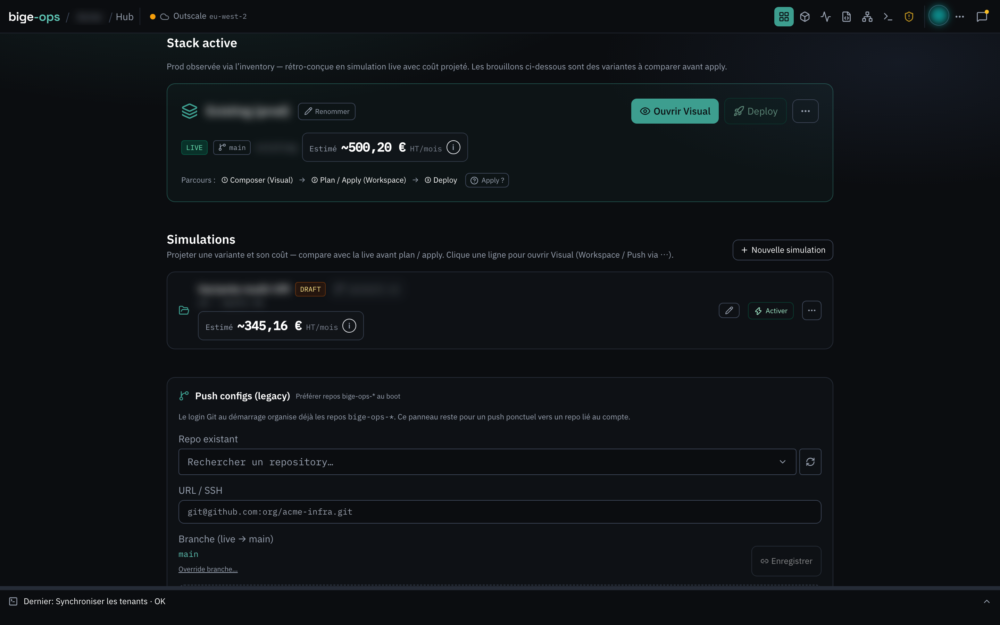
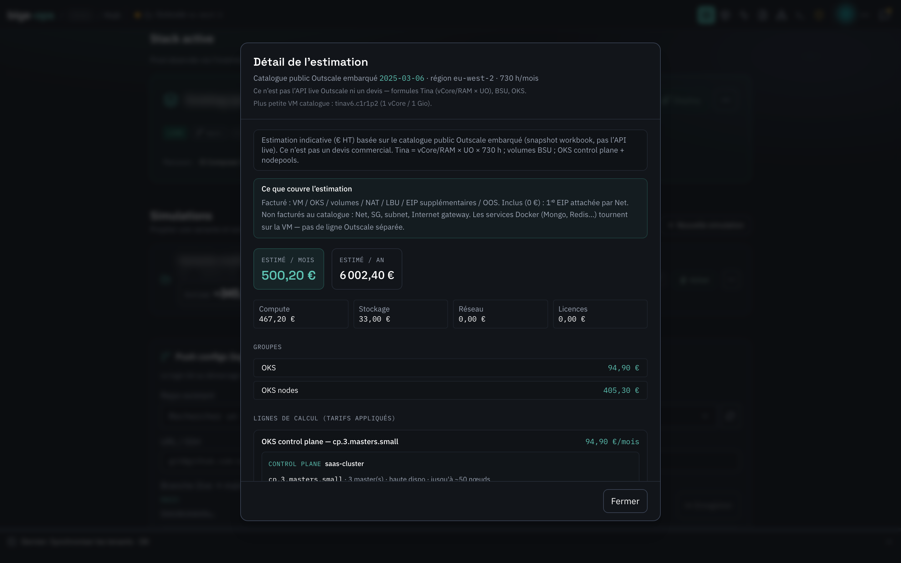

  

<h1 align="center">bige-ops</h1>

  <strong>Le simulateur de stack pour Outscale</strong> 
  Dessine ta stack, teste-la, mesure son coût, puis déploie-la sur ton compte Outscale. 
  <em>Gratuit · installé en une commande · ta stack sur ton compte Outscale</em>

  <!-- macOS DMG download hidden until the app is notarized: install with Homebrew.
   -->
  

  <strong>macOS (Apple Silicon)</strong> 
  <code>brew install --cask simondelamarre/bige-ops/bige-ops</code>

  <a href="https://bige.dev/"><strong>bige.dev</strong></a> ·
  <a href="https://bige.dev/outscale.html">Outscale</a> ·
  <a href="https://bige.dev/oks.html">OKS</a> ·
  <a href="https://bige.dev/documentation.html">documentation</a> ·
  <a href="https://bige.dev/install.html">installer</a>

---

## Démarrer en 3 étapes

1. **Installe**, c’est gratuit : `brew install --cask simondelamarre/bige-ops/bige-ops` sur macOS, ou l’AppImage / le .deb sur Linux ([dernière release](https://github.com/simondelamarre/bige-ops-releases/releases/latest)).
2. **Ouvre bige-ops**, connecte-toi avec GitHub (tes configurations y sont versionnées), choisis un dossier de travail et pars d’une topologie prête : mono-VM, multi-VM ou Kubernetes (OKS).
3. **Lis le résultat** : coût mensuel, risques et vulnérabilités. Tu connectes ton compte Outscale seulement quand tu veux déployer.

## Pourquoi bige-ops

Tu simules, tu testes, tu déploies sur Outscale — puis tu analyses et tu corriges.

### 1. Simule avant de déployer.
**bige-ops est un simulateur de stack pour Outscale.** Tu dessines ta stack (VMs, cluster OKS, stockage, réseau), tu vois son coût mensuel et tu la testes avant de dépenser un euro. Quand elle te convient, tu la déploies sur ton compte : Terraform et manifests Kubernetes sont générés pour toi.

### 2. Construit pour Outscale.
**Cloud souverain français, régions classiques et SecNumCloud.** Chaque brique du simulateur correspond à un service Outscale (VMs Tina, OKS, volumes BSU, Object Storage, LBU), avec son prix public. Tu planifies, tu appliques et tu suis tes coûts sur Outscale, y compris en SecNumCloud.

### 3. La simplicité d’une plateforme, sur ton cloud.
**Ce n’est pas un Docker sur ton poste : c’est ta prod, sur Outscale.** Un Docker sur ton poste fait tourner des conteneurs pour toi, en local. bige-ops, lui, pilote ta production : tu relies ton dépôt Git, il génère l’infra et déploie tes services sur des VMs ou un cluster OKS de ton compte Outscale. Tu gardes la simplicité d’une plateforme managée, avec la main sur ton infra et le prix public d’Outscale. Tes secrets restent chez toi : coffre local, sync optionnelle vers GitHub ou HashiCorp Vault.

### 4. Tu peux commencer sans compte Outscale.
**Tu simules d’abord. Tu te connectes quand tu appliques.** Sans identifiants Outscale, tu explores, tu simules et tu estimes. Tu te connectes seulement pour l’inventaire, le plan et l’apply, quand tu es prêt.

  

  

### 5. Tes vulnérabilités, en direct.
**Sans LLM ni clé : l’analyse tourne sur ton poste.** bige-ops lit les dépôts de ta stack avec un vrai parseur de code (tree-sitter) et croise avec ce que ta stack expose : dépendances npm et PyPI rapprochées des vulnérabilités connues ([OSV](https://osv.dev/)), failles courantes dans le code (injections, XSS, secrets, CORS) et routes exposées sans authentification : les trous béants ressortent en quelques minutes. Avec ta clé [OpenCVE](https://www.opencve.io/), les images de ta stack sont confrontées au référentiel CVE d’OpenCVE : tu vois les premières vulnérabilités avant de déployer. Rapport Markdown ou PDF.

   
  <em>Une injection SQL réelle dans <a href="https://owasp.org/projects/juice-shop">OWASP Juice Shop</a>, dépôt public volontairement vulnérable : chacun peut la vérifier.</em>

   
  <em>CVE-2022-25887 sur sanitize-html 1.4.2, avec son lien vers OpenCVE.</em>

### 6. Le game changer : l’analyse profonde.
**bige-ops advanced, avec ta propre clé LLM.** Un agent d’audit parcourt tes dépôts en profondeur, avec le contexte de ta stack cloud : ce qui est exposé, et par quelles routes. Il remonte des failles classées par CWE, avec une issue GitHub proposée pour chacune. Tu branches ta clé (Anthropic, OpenAI, Google Gemini, Mistral) : les appels partent de ton poste, rien n’est gardé chez nous.

### 7. On t’écoute.
**Un bug ou une idée : tu l’ouvres sur GitHub.** Le dépôt public reçoit tes [issues](https://github.com/simondelamarre/bige-ops-releases/issues/new/choose) et tes demandes de fonctions. On les lit, on priorise, on répond, sans toucher à ton graphe ni à tes secrets.

## 100 % Outscale

bige-ops est construit pour Outscale, cloud souverain français, sur les régions classiques comme sur SecNumCloud. → [Pourquoi Outscale](https://bige.dev/pourquoi-outscale.html)

| | |
|---|---|
| **Calcul** | VMs Tina, en mono-VM ou multi-VM, réseau Net et Security Groups, IP publiques |
| **Kubernetes** | OKS : cluster, nodepools, scale horizontal et vertical, HPA, HTTPS via certificat EIM |
| **Stockage** | Volumes BSU (gp2, io1 avec IOPS provisionnées), snapshots, Object Storage (OOS) |
| **Exposition** | LBU (load balancer) et HTTPS |
| **Bases** | MongoDB, PostgreSQL, MySQL, Redis… en VM ou sur OKS, sauvegardes vers OOS |
| **Coûts** | Catalogue public Outscale, synchronisé via l'API |

<!-- Other clouds hidden for now (see ENABLED_PROVIDER_IDS in desktop/src/lib/providers.ts).
Previous copy, to restore with them:
<em>Outscale live · Scaleway, OVH, AWS, Azure, GCP, Fly… bientôt</em>
**En cours :** Scaleway, OVHcloud, AWS, Azure, GCP, Fly.io — listés dans l’app, pas encore materialization / pricing complets.
| Bientôt | Scaleway · OVH · AWS · Azure · GCP · Fly |
- Tarifs : sync catalogue OAPI · formulaires VM par cloud · Fly (WIP)
-->

## En bref

| | |
|---|---|
| **Prix** | Gratuit : la facture cloud reste chez Outscale |
| **Outil** | Sur ta machine (macOS, Linux) : app desktop et CLI |
| **Stack** | Sur ton compte Outscale |
| **Secrets** | Dans un coffre local, jamais envoyés à un service bige-ops |

---

## Installer

| | |
|---|---|
| **macOS** (Apple Silicon) | `brew install --cask simondelamarre/bige-ops/bige-ops` |
| **Linux** (x86_64) | AppImage ou .deb : [dernière release](https://github.com/simondelamarre/bige-ops-releases/releases/latest) |

Le cask Homebrew prépare l’app pour le premier lancement : elle s’ouvre directement. Guide complet : [bige.dev/install.html](https://bige.dev/install.html).

Une question, un retour, une idée : [ouvre une issue](https://github.com/simondelamarre/bige-ops-releases/issues/new/choose).

  <!-- macOS DMG download hidden until the app is notarized: install with Homebrew.
   -->
  

