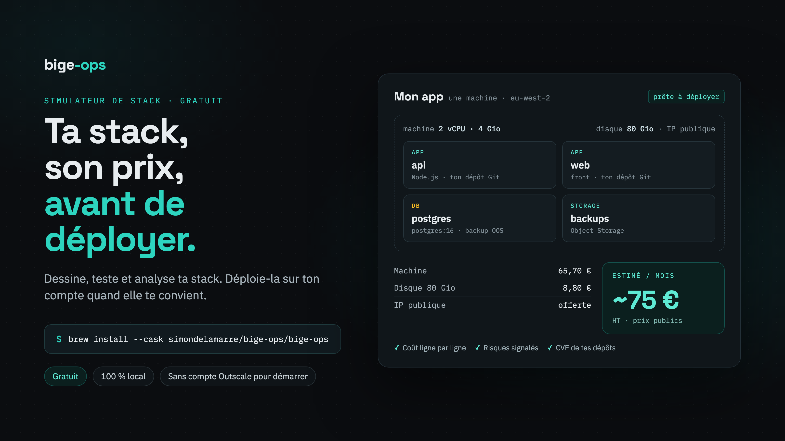
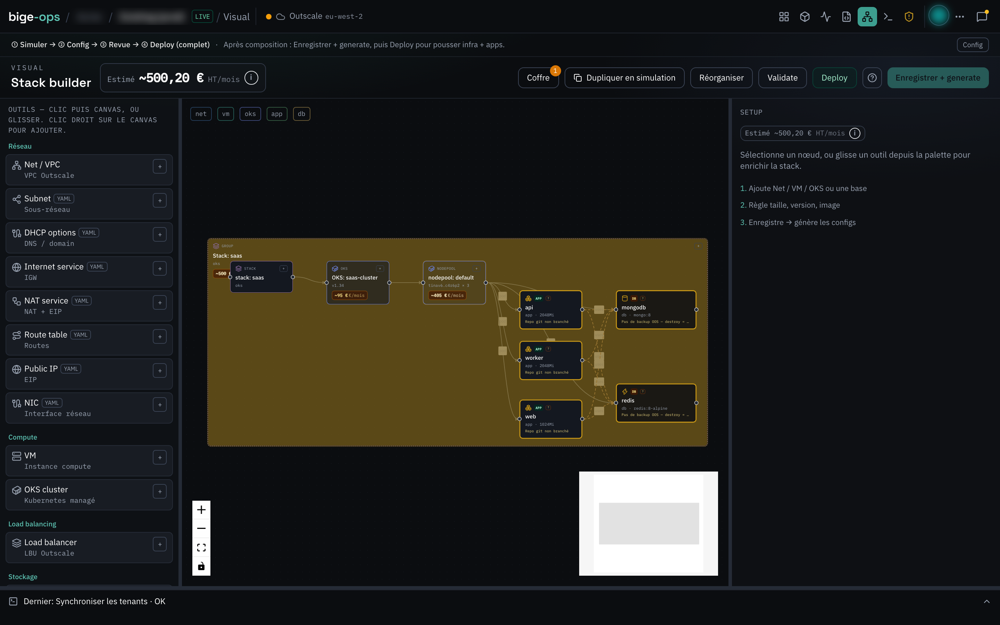
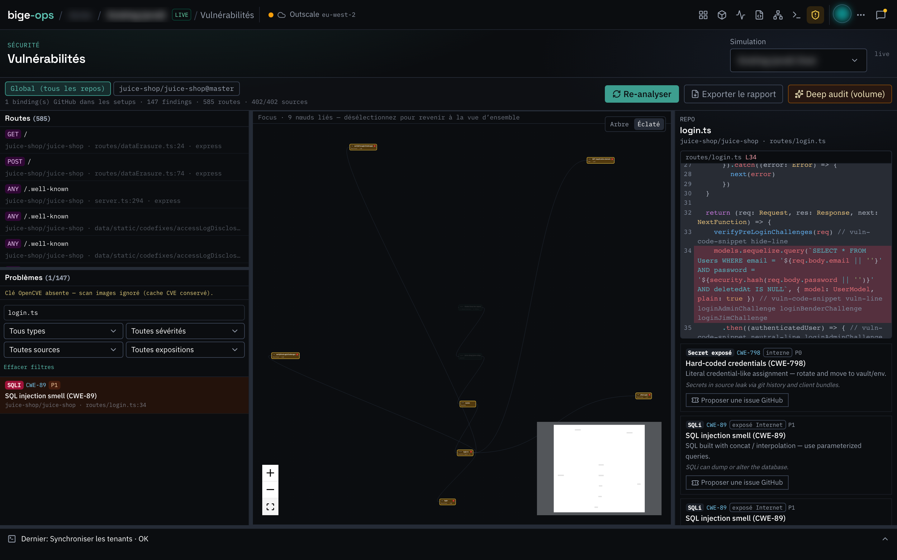
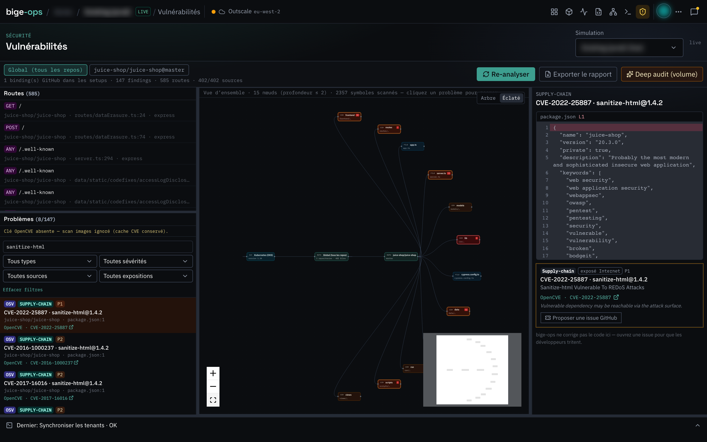
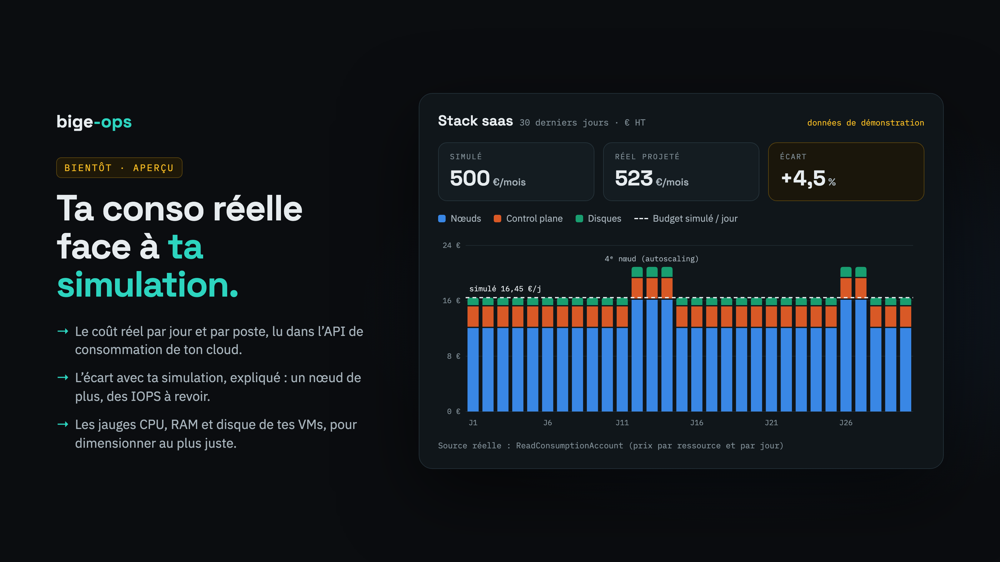

  

<h1 align="center">bige-ops</h1>

  <strong>Ta stack, son prix, avant de déployer.</strong> 
  Gratuit. Local. Installé en une commande.

  <code>brew install --cask simondelamarre/bige-ops/bige-ops</code>

  <!-- macOS DMG download hidden until the app is notarized: install with Homebrew.
   -->
  

  <a href="https://bige.dev/"><strong>bige.dev</strong></a> ·
  <a href="https://bige.dev/layouts.html">par où commencer</a> ·
  <a href="https://bige.dev/documentation.html">documentation</a> ·
  <a href="https://github.com/simondelamarre/bige-ops-releases/issues/new/choose">une idée ?</a>

---

## En 3 étapes

1. **Installe.** `brew install --cask simondelamarre/bige-ops/bige-ops` sur macOS, AppImage ou .deb sur Linux.
2. **Simule.** Connecte-toi avec GitHub, pars d’une topologie prête : une machine, app et données séparées, ou Kubernetes.
3. **Décide.** Coût, risques, vulnérabilités. Tu déploies sur ton compte quand tu veux.

## Ce que tu y gagnes

- **Le prix avant la facture.** VMs, Kubernetes, bases, stockage : chaque ligne chiffrée sur la grille publique.
- **La simplicité d’une plateforme, sur ton cloud.** Tu relies ton dépôt, bige-ops déploie. Pas besoin de DevOps.
- **Des bases réglées pour leur usage.** Disque, IOPS, sauvegardes : les bons défauts, ajustables en voyant le coût.
- **Tes failles, par ordre d’urgence.** Il y en aura toujours : bige-ops les affiche et met en tête celles que ta stack expose. Pages ouvertes sans connexion, mots de passe en clair, failles connues de tes bibliothèques. Sur ton poste, sans clé ni IA.
- **L’audit profond en option.** bige-ops advanced lit ton code plus en profondeur avec ta propre clé d’IA, classe chaque faille par type (catalogue CWE) et propose une issue GitHub par problème.
- **La main sur tout.** Outil local, secrets chez toi, infra sur ton compte.

   
  <em>Le Visual : ta stack, ses services, son coût.</em>

   
  <em>Une faille réelle dans <a href="https://owasp.org/projects/juice-shop">OWASP Juice Shop</a> : une requête à la base construite avec ce que tape l’utilisateur (injection SQL), exposée à Internet. Vérifiable par tous.</em>

   
  <em>Une faille connue (CVE-2022-25887) dans la bibliothèque sanitize-html, avec son lien <a href="https://www.opencve.io/">OpenCVE</a>.</em>

## Comment bige-ops trouve tes failles

1. Il lit le code de tes dépôts, sur ton poste.
2. Il repère les pages et les API que ton app expose, et vérifie qu’elles demandent une connexion.
3. Il cherche les erreurs classiques : mots de passe écrits en clair, requêtes à la base construites avec ce que tape l’utilisateur, API ouverte à n’importe quel site.
4. Il compare tes bibliothèques à la base publique des failles connues ([OSV](https://osv.dev/)) et, avec ta clé [OpenCVE](https://www.opencve.io/), ta stack au registre mondial des failles (CVE).
5. Il classe tout par urgence : ce qui est exposé à Internet d’abord.

**Pourquoi le refaire toi-même ?** C’est chez toi, et c’est gratuit.

## Bientôt : ta conso réelle face à ta simulation

   
  <em>Aperçu, données de démonstration. Source réelle : l’API de consommation du cloud.</em>

## Le cloud

Construit pour [Outscale](https://bige.dev/pourquoi-outscale.html) : cloud souverain français, régions classiques et SecNumCloud.

## Installer

| | |
|---|---|
| **macOS** (Apple Silicon) | `brew install --cask simondelamarre/bige-ops/bige-ops` |
| **Linux** (x86_64) | AppImage ou .deb : [dernière release](https://github.com/simondelamarre/bige-ops-releases/releases/latest) |

Guide complet : [bige.dev/install.html](https://bige.dev/install.html) · Une question : [ouvre une issue](https://github.com/simondelamarre/bige-ops-releases/issues/new/choose).

<!-- Other clouds hidden for now (see ENABLED_PROVIDER_IDS in desktop/src/lib/providers.ts).
Previous copy, to restore with them:
<em>Outscale live · Scaleway, OVH, AWS, Azure, GCP, Fly… bientôt</em>
**En cours :** Scaleway, OVHcloud, AWS, Azure, GCP, Fly.io — listés dans l’app, pas encore materialization / pricing complets.
| Bientôt | Scaleway · OVH · AWS · Azure · GCP · Fly |
- Tarifs : sync catalogue OAPI · formulaires VM par cloud · Fly (WIP)
-->

---

### Installe maintenant. La suite, c’est toi qui choisis.

Ta stack est décrite une fois, dans un format ouvert, versionné dans ton Git. Quand d’autres clouds français arriveront dans bige-ops ([OVHcloud](https://www.ovhcloud.com/fr/), [Scaleway](https://www.scaleway.com/fr/)), tu compareras la même stack, prix à l’appui, et tu migreras si ça vaut le coup. Sans tout réécrire.
