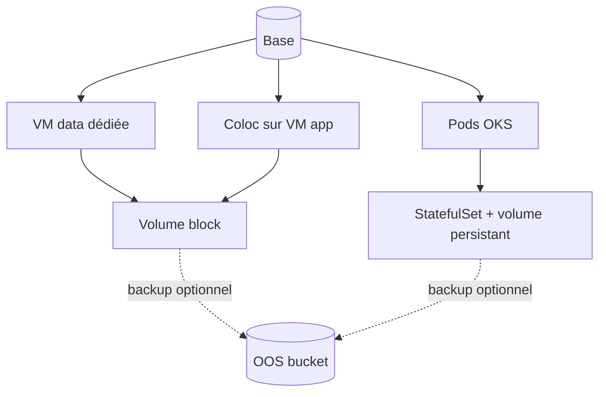

# Bases de données

Postgres, Mongo, Redis (et customs) : choisir **où** ça tourne (coloc VM, VM dédiée, pods OKS), régler réplicas et volumes dans le formulaire — le setup se met à jour **tout de suite**. Les sauvegardes se règlent sur la base, et son panneau **Données** fait le dump, la restauration et la migration ; le tuning fin reste le tien.

## Coloc vs VM dédiée

**Coloc** = app + data sur la même VM (démarrage). **VM dédiée** = isolement data, racine `io1` par défaut + volume BSU attaché. Le formulaire Visual réécrit la simulation sans re-interview.

## VM data partagée (multi-VM)

En multi-VM, une petite base peut tourner sur la VM privée d’une autre base au lieu d’avoir la sienne : champ **Machine** de l’inspecteur, ou `service_config.redis.colocate_with: weaviate`. Une VM de moins dans l’estimation ; la VM hôte garde sa taille, ses groupes de sécurité s’additionnent, deploy et backups suivent. La validation refuse deux bases sur le même port (MySQL + MariaDB) ou une VM hôte trop petite pour la mémoire déclarée. Déplacer une base déjà déployée ne copie pas ses données.

## OKS : StatefulSet et volume persistant

Chaque base est un StatefulSet sur volume persistant (PVC 10 GiB par défaut, classe par défaut du cluster ; `storage_gb` / `storage_class` par base). MongoDB : `service_config.mongodb.replicas` à 1, 3 ou 5 pose un replica set ; les autres bases restent à un pod. Le filet est le backup vers OOS (un CronJob par base).

## Storage & OOS

Volume BSU + snapshot = filet bloc. **OOS** = Object Storage compatible S3 pour les dumps applicatifs, planifiés par le deploy (cron, ou CronJob sur OKS). Voir [oos.md](oos.md).

Pages HTML (diagrammes) : [bases.html](https://bige.dev/bases.html) · [oos.html](https://bige.dev/oos.html)
