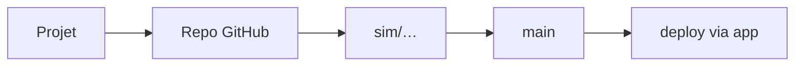

# GitHub config-history

- Créer un projet → **nouveau repo** GitHub privé `*-infra` (ou repo existant lié)
- Créer une simulation → branche **`sim/<id>`**
- Promote → **`main`** (live)
- **Deploy** via l’**app** + **sync GitHub** ; avec un token, push automatique après chaque Save, jamais de suppression de branche distante
- Rollback cloud = snapshot local + plan/apply ; rollback Git avancé = sur GitHub

## Les branches

Une simulation = une branche ; `main` = ce qui est déployable ; historique auditable. Conflits et pull requests se mènent sur GitHub ; si une synchro échoue → GitHub, puis resync / plan / apply.

HTML : [github-config.html](https://bige.dev/github-config.html)

Mode expert (fichiers, diffs, commits) : [expert-config.html](https://bige.dev/expert-config.html)

Repos app · VMs · Dockerfiles : [repos-vms-docker.html](https://bige.dev/repos-vms-docker.html)
