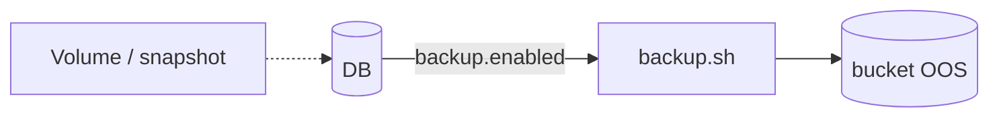

# OOS & backups

**OOS** = OUTSCALE Object Storage, compatible avec l’API S3. Stockage régional : erasure coding et réplication entre zones, un objet reste lisible même si une zone tombe. Endpoint `https://oos.<région>.outscale.com` dans les cinq Régions. Au catalogue public, trafic sortant et requêtes à 0 € HT en `eu-west-2`, `cloudgouv-eu-west-1`, `us-east-2` et `us-west-1`.

Déclarer `oos_bucket`, `generate` → ressources Terraform S3 sur l’endpoint OOS régional, apply sur ton compte. Activer le backup d’une base ajoute un bucket `<stack>-backups` ; `backup.sh` est préparé (bucket, endpoint, planning, rétention visée) et tu y branches le dump. Access keys hors `project.yaml` ; OOS n’accepte pas les utilisateurs EIM.

Nom de bucket : unique dans la Région, 3 à 63 caractères (minuscules, chiffres, tirets), non renommable.

## Un bucket protégé

`prevent_destroy` dans le Terraform ; `plan`, `apply` et `inventory clean` refusent toute destruction d’Object Storage. Les buckets sont enregistrés dans `shared.yaml` et visibles sur **chaque** simulation du compte. Retrait explicite : `bige-ops storage remove --name <bucket>` (ou l’inspector Visual), accepté si le bucket est vide ou pas encore créé, refusé s’il contient des objets.

## Sans backup, pas de filet

Sans `backup.enabled` + bucket OOS sur une base, l’app te le signale (Visual, préflight, plan). À la destruction : mono-VM = app + base sur le même disque ; multi-VM = VM data.

Doc Outscale : [À propos d’OOS](https://docs.outscale.com/fr/userguide/À-propos-d-OOS.html) · [Introduction à OOS](https://docs.outscale.com/fr/userguide/Introduction-à-OOS.html) · [Mécanismes de résilience](https://docs.outscale.com/fr/userguide/Mécanismes-de-résilience-d-OOS.html)

HTML : [oos.html](https://bige.dev/oos.html)
