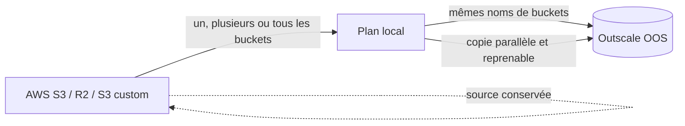
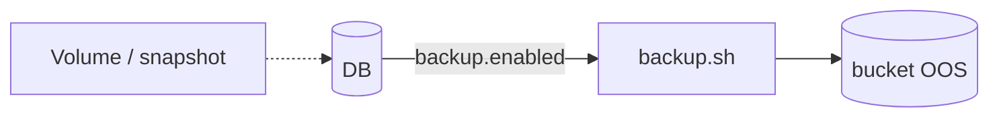

# Object Storage · S3, R2, OOS & backups

Connecte **AWS S3**, **Cloudflare R2**, **Outscale OOS** ou un endpoint
compatible S3 pour explorer, prévisualiser et transférer tes objets. Bige Ops
peut reproduire un ou plusieurs buckets sur OOS, conserver leurs noms et
reprendre une copie interrompue sans supprimer la source.

**OOS** = OUTSCALE Object Storage, compatible avec l’API S3. Stockage régional : erasure coding et réplication entre zones, un objet reste lisible même si une zone tombe. Endpoint `https://oos.<région>.outscale.com` dans les cinq Régions. Au catalogue public, trafic sortant et requêtes à 0 € HT en `eu-west-2`, `cloudgouv-eu-west-1`, `us-east-2` et `us-west-1`.

> **Deux usages séparés.** Le **Storage Explorer** sert à parcourir, rechercher,
> prévisualiser, transférer et migrer les objets d’un bucket. Les **backups de
> bases de données** utilisent aussi un bucket, mais gardent leur propre
> configuration, leur planning, leur rétention et leur restauration.

## Storage Explorer multi-provider

Dans l’app, l’onglet **Storage** accepte AWS S3, OOS, Cloudflare R2 et un
endpoint compatible S3. Une connexion manuelle et ses secrets restent dans le
workspace courant ; elle n’apparaît pas dans les autres espaces de travail. Les
buckets OOS déjà détectés dans l’inventaire peuvent être ouverts directement par
une connexion gérée liée au compte.

- arbre paresseux dossiers/fichiers, fil d’Ariane et recherche bornée par lots ;
- poids des objets courants et nombre d’objets, sans les présenter comme la
  facture exacte ;
- diagnostic conservateur d’exposition publique : privé, potentiellement public
  ou inconnu selon les contrôles réellement lisibles ;
- métadonnées, tags, nom original lorsqu’il existe, aperçu local intégré,
  téléchargement, upload et suppression confirmée ;
- migration Source → Destination avec plan basé sur les métadonnées, copies
  parallèles, reprise après interruption, recherche différentielle des clés
  manquantes, vérification et absence d’écrasement ; la source n’est jamais
  supprimée automatiquement ;
- migration de plusieurs ou de tous les buckets d'une connexion S3 vers OOS :
  les buckets manquants sont créés avec exactement les mêmes noms, puis chaque
  copie est suivie et reprenable séparément ;
- suppression récursive d'un dossier ou d'un bucket avec inventaire préalable,
  confirmation exacte et progression persistante. Les versions, marqueurs de
  suppression et uploads multipart sont inclus dans la purge explicite.

## Migrer une connexion vers OOS

1. Choisis la connexion source AWS S3, R2 ou S3 compatible.
2. Sélectionne un bucket, plusieurs buckets ou toute la connexion.
3. Choisis la connexion Outscale OOS de destination et prépare le plan.
4. Bige Ops crée les buckets OOS manquants avec exactement les mêmes noms, puis
   copie les objets en parallèle.

Le plan ne télécharge que les listes et métadonnées. Les contenus sont transférés
au lancement, avec un nombre borné de fichiers temporaires. Si l'app est fermée
ou qu'une requête échoue, **Reprendre** continue les objets non terminés ou non
vérifiés. Les objets déjà présents dans la destination ne sont jamais écrasés
silencieusement et la source n'est jamais supprimée automatiquement.

OOS refuse certaines clés contenant des caractères de contrôle/non imprimables.
Bige Ops ne les renomme jamais silencieusement : elles restent dans la source et
la migration se termine avec une alerte détaillée afin de permettre une
correction ciblée de l'objet et, si nécessaire, de sa référence applicative.

Les aperçus sont téléchargés dans un cache privé et borné du workspace. Images,
texte, PDF, audio, vidéo et principaux formats bureautiques sont rendus dans
l’app lorsque le format le permet ; sinon l’utilisateur choisit explicitement le
téléchargement ou l’application système.

Déclarer `oos_bucket`, `generate` → ressources Terraform S3 sur l’endpoint OOS régional, apply sur ton compte. Activer le backup d’une base ajoute un bucket `<stack>-backups` ; `backup.sh` est préparé (bucket, endpoint, planning, rétention visée) et tu y branches le dump. Access keys hors `project.yaml` ; OOS n’accepte pas les utilisateurs EIM.

Nom de bucket : unique dans la Région, 3 à 63 caractères (minuscules, chiffres, tirets), non renommable.

## Un bucket protégé

`prevent_destroy` dans le Terraform ; `plan`, `apply` et `inventory clean`
refusent toute destruction implicite d’Object Storage. Le catalogue des buckets
du compte est enregistré dans `shared.yaml` et visible dans l’Inventaire et le
Storage Explorer. Un Visual n’affiche que les buckets explicitement attachés à
sa simulation ; les retirer du Visual ne supprime jamais le bucket cloud.

La suppression cloud se fait uniquement depuis le Storage Explorer, avec saisie
du nom exact. Un bucket vide peut être supprimé directement. Pour un bucket non
vide, l’app doit d’abord inspecter objets courants, versions, marqueurs de
suppression et uploads multipart, puis demander une confirmation explicite de
purge avant la suppression définitive.

## Sans backup, pas de filet

Sans `backup.enabled` + bucket OOS sur une base, l’app te le signale (Visual, préflight, plan). À la destruction : mono-VM = app + base sur le même disque ; multi-VM = VM data.

Doc Outscale : [À propos d’OOS](https://docs.outscale.com/fr/userguide/À-propos-d-OOS.html) · [Introduction à OOS](https://docs.outscale.com/fr/userguide/Introduction-à-OOS.html) · [Mécanismes de résilience](https://docs.outscale.com/fr/userguide/Mécanismes-de-résilience-d-OOS.html)

HTML : [oos.html](https://bige.dev/oos.html)
