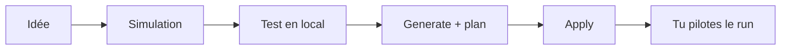

# Périmètre

Simple comme un PaaS, flexible comme un IaaS : bige-ops simule ta stack, la teste en local, la déploie sur ton compte Outscale, migre tes données et analyse tes failles. Il pose une stack propre sur ton compte ; **ensuite, tu pilotes l’exploitation.**

HTML : [perimetre.html](https://bige.dev/perimetre.html)
