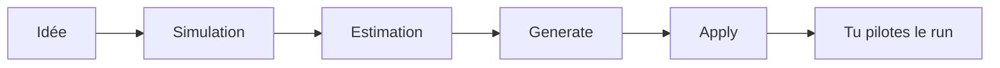

# Périmètre

bige-ops est un simulateur et un kit de démarrage pour Outscale : projeter, estimer, composer, générer, appliquer. Il pose une stack propre sur ton compte ; **ensuite, tu pilotes l’exploitation.**

HTML : [perimetre.html](https://bige.dev/perimetre.html)
